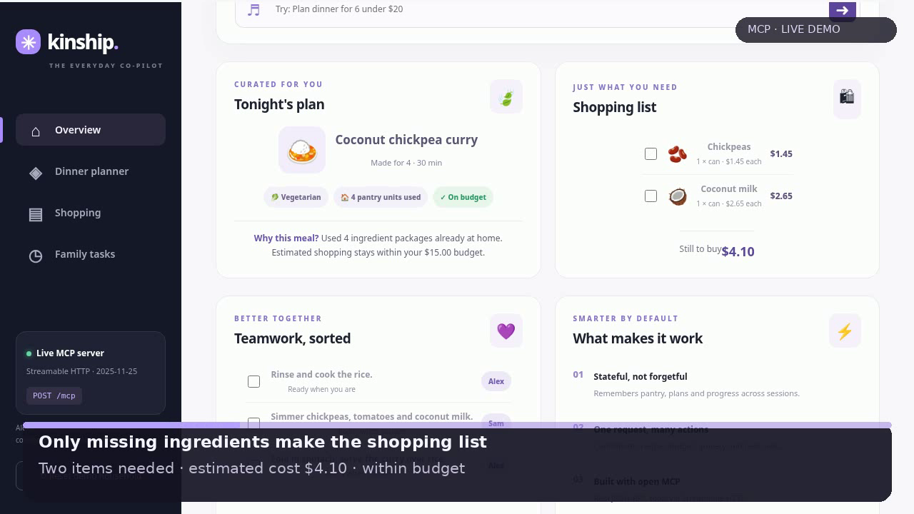
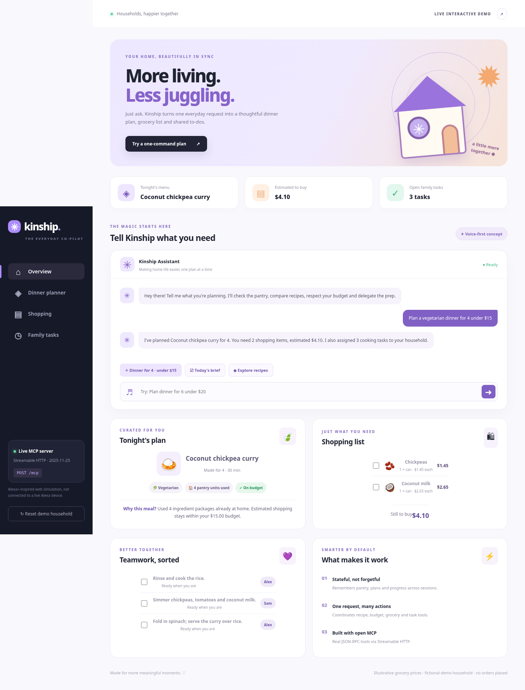
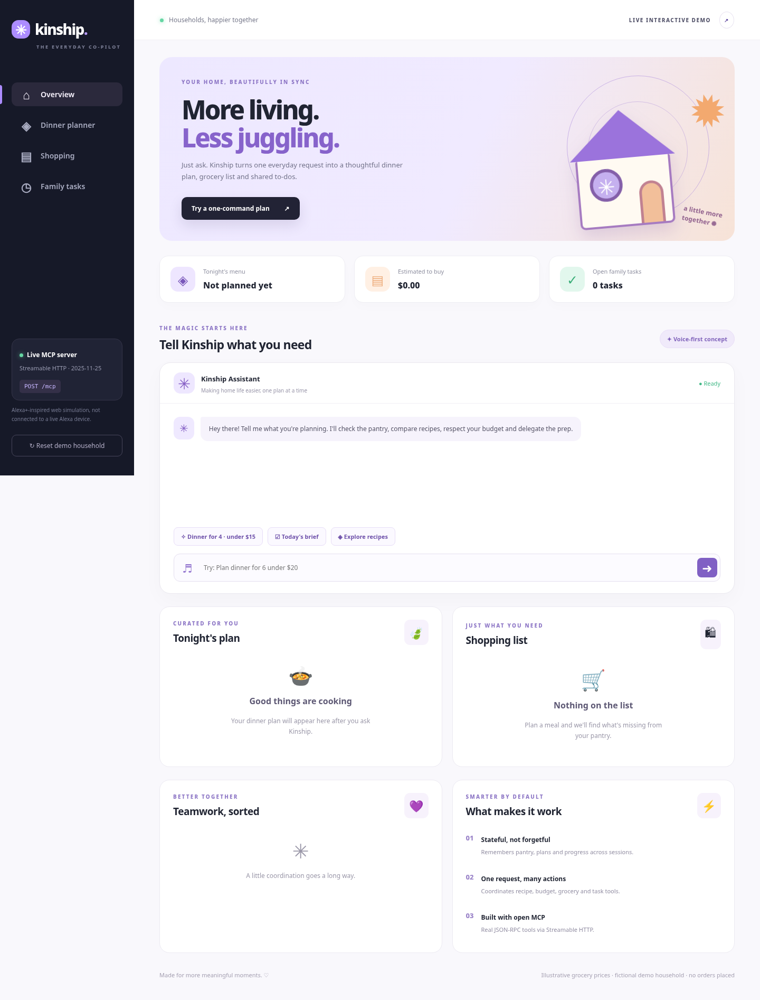
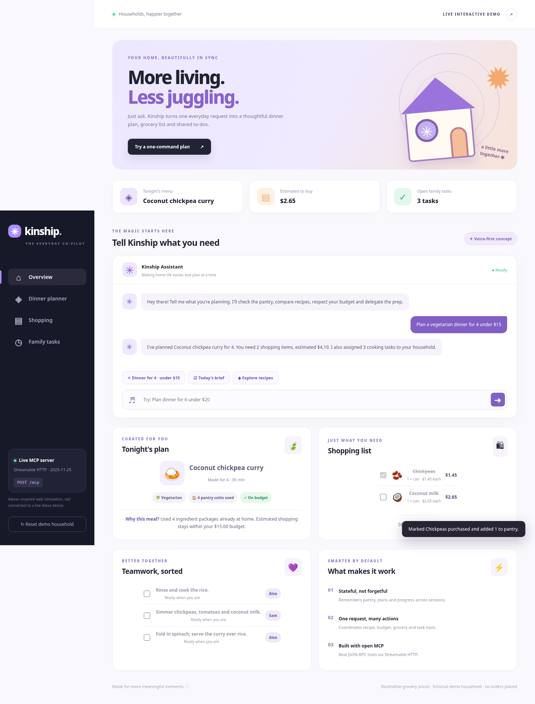
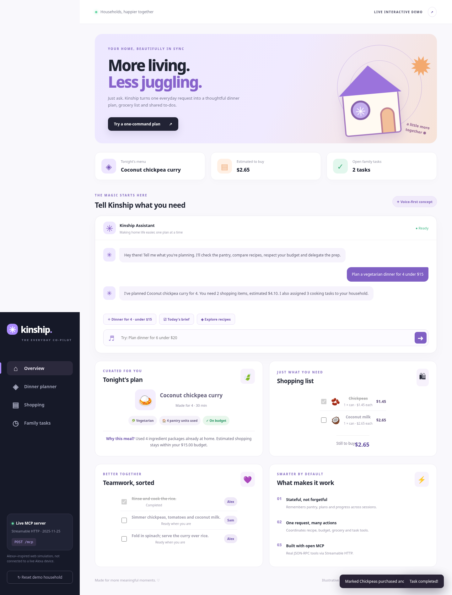
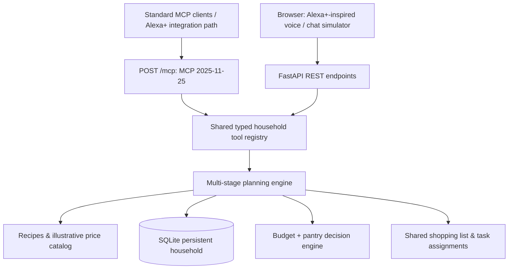

# ✳ Kinship — More Living, Less Juggling

**An Alexa+-inspired household planning assistant with a self-hosted MCP server (Streamable HTTP, protocol version 2025-11-25).**

Built as a project submission candidate for **Build, Ship, Shape: Amazon Developer Hackathon 2026**, Alexa+ track.

**Project maintainer:** **Tushar Kumar** ([GitHub @Tusharbhushansingh](https://github.com/Tusharbhushansingh)) · **Demo:** [Kinship on YouTube](https://youtu.be/VnGu595roKs)

*This project was developed with AI-assisted coding and documentation. Its features and limitations are described below.*

> **Integration disclosure:** Kinship exposes real MCP tools, but its browser dashboard is an Alexa+-inspired simulator. It does **not** connect to an Echo device or claim access to a live Alexa+ service. Its intent recognition uses rules, not a generative language model.

## 🎬 Watch the project demo

[](https://youtu.be/VnGu595roKs)

**▶ [Watch the Kinship demo on YouTube](https://youtu.be/VnGu595roKs)**

The repository also includes the [original silent demonstration](assets/kinship-demo.mp4) and a [narration script](docs/NARRATION_SCRIPT.md). The YouTube video is supplied by the project entrant; it is a video link, not a YouTube channel URL.

## 📸 Application screenshots

**Dinner plan and dashboard**



| Initial household view | Grocery-list progress |
| --- | --- |
|  |  |

**Cooking-task progress**



## Why Kinship?

"What should we cook tonight?" sounds simple, but answering it usually takes several apps: check the pantry, compare recipes, check cost, make a grocery list, and share responsibilities. Kinship takes one natural-language request and coordinates **five practical actions**, not just a chat response.

**Sample:** “Plan a vegetarian dinner for 4 under $15.”

1. Reads existing pantry stock from SQLite.
2. Estimates quantities and illustrative grocery cost across five complete recipe candidates.
3. Chooses a budget-feasible meal with a transparent pantry-reuse heuristic; explains if no recipe fits.
4. Generates a persistent *draft* shopping list of exactly the missing items (no real purchases).
5. Allocates three cooking tasks between fictional household members Alex and Sam.

The user can mark ingredients as purchased, complete steps, ask “What's left to do?”, then reload to find the current state still available. The same state-changing operations are available to standard MCP clients, not just the web frontend.

## 🚀 Run Kinship locally

Requires **Python 3.10+**.

**macOS / Linux:**

```bash
git clone https://github.com/Tusharbhushansingh/Kinship.git
cd Kinship
python3 -m venv .venv
source .venv/bin/activate
python -m pip install -r requirements.txt
python -m uvicorn app.main:app --host 127.0.0.1 --port 8000
```

**Windows PowerShell:** After cloning and opening the `Kinship` folder, run `py -m venv .venv`, then `.venv\Scripts\Activate.ps1`, install the dependencies, and start the same Uvicorn command.

If PowerShell blocks activation, use `.venv\Scripts\python.exe -m pip install -r requirements.txt` and `.venv\Scripts\python.exe -m uvicorn app.main:app --host 127.0.0.1 --port 8000` instead.

Open **http://127.0.0.1:8000**. Click **Dinner for 4 · under $15**, tick an ingredient, tick a cooking task, and then click **Today's brief**. Use **Reset demo household** to replay.

**Docker alternative:**

```bash
docker build -t kinship .
docker run --rm -p 127.0.0.1:8000:8000 kinship
```

For durable Docker state, mount a volume and set `KINSHIP_DB=/data/kinship.db` (sample DB is reset on a fresh container otherwise).

## 🔌 Real MCP transport

- **Endpoint:** `POST http://127.0.0.1:8000/mcp`.
- **Version:** `2025-11-25` (minimum specified by the Alexa+ hackathon track).
- **Transport:** Streamable HTTP, JSON-RPC 2.0, stateless JSON response mode.
- **Discovery:** `initialize`, `notifications/initialized`, `tools/list`, `tools/call`, `ping`.
- **Tools:** `household_brief`, `plan_dinner`, `list_products`, `list_recipes`, `add_pantry_item`, `mark_item_purchased`, `complete_cooking_task`, `reset_demo`.
- GET intentionally returns HTTP 405 (permitted when the server does not supply a standalone SSE stream); POST notifications return HTTP 202.

**Verify without installing a special MCP client:**

```bash
curl -s http://127.0.0.1:8000/mcp \
  -H 'Content-Type: application/json' \
  -H 'Accept: application/json, text/event-stream' \
  -H 'MCP-Protocol-Version: 2025-11-25' \
  --data '{"jsonrpc":"2.0","id":1,"method":"initialize","params":{"protocolVersion":"2025-11-25","capabilities":{},"clientInfo":{"name":"quickstart","version":"1.0"}}}'
```

Next, enumerate the tools:

```bash
curl -s http://127.0.0.1:8000/mcp \
  -H 'Content-Type: application/json' \
  -H 'Accept: application/json, text/event-stream' \
  -H 'MCP-Protocol-Version: 2025-11-25' \
  --data '{"jsonrpc":"2.0","id":2,"method":"tools/list"}'
```

And plan dinner via *the actual MCP transport*:

```bash
curl -s http://127.0.0.1:8000/mcp \
  -H 'Content-Type: application/json' \
  -H 'Accept: application/json, text/event-stream' \
  -H 'MCP-Protocol-Version: 2025-11-25' \
  --data '{"jsonrpc":"2.0","id":3,"method":"tools/call","params":{"name":"plan_dinner","arguments":{"servings":4,"max_budget":15,"preference":"vegetarian"}}}'
```

On Windows, use PowerShell's `curl.exe` or the included `scripts/mcp_demo.py` Python client instead.

## 🧩 Architecture



The intent dispatcher is explicitly *rule-based*, not a claimed LLM integration. It recognizes a limited set of useful natural-language commands, while an MCP-capable agent can call the actual tools with structured arguments. This makes the prototype reliable without keys, accounts or network services. Browser speech recognition is offered when the browser supports it; type commands otherwise.

### Repository map

```text
app/main.py            FastAPI REST app and transparent text intent dispatcher
app/mcp_protocol.py    MCP 2025-11-25 Streamable HTTP protocol and tool registry
app/engine.py          Household state, planning algorithm and persistent actions
app/catalog.py         Local demonstration recipe and grocery dataset
static/                Responsive web simulator, accessible controls
assets/                Screenshots from an actual running instance
scripts/mcp_demo.py    End-to-end MCP requests from a plain Python client
tests/                 Full REST workflow, MCP handshake, version/origin/auth tests
docs/                  Devpost submission copy, product feedback, demo guide
Dockerfile             Reproducible self-hosted runtime
LICENSE                MIT open-source project license
```

## ✅ Automated tests

```bash
pip install -r requirements-dev.txt
python -m pytest -q
```

Expected: 3 passing tests. Tests isolate SQLite to a temporary DB and cover real ASGI requests through the MCP and REST endpoints. Tested in a container with FastAPI 0.128.2, Python 3.13 and httpx 0.28.1; judges can rerun.

## 🛠️ Deployment and evaluation

The included Dockerfile runs the same app in a self-hosted container. Local-only setup is sufficient for a reproducible judge walkthrough. To host it publicly, deploy Docker to any provider, use HTTPS, and configure a strong `MCP_API_KEY` (Bearer auth on `/mcp`) plus explicit `MCP_ALLOWED_ORIGINS`. Keep the UI in a controlled demo environment: as shipped, all UI visitors share the **same fictional household state**, and `/api` endpoints are not authenticated. Do **not** put real household names, shopping or payment details in this demo. Use a reverse-proxy access control layer and isolated storage/users before any production deployment.

No real grocery purchase, paid API, Amazon consumer data, calendars, notifications, healthcare advice, or Alexa+ device integration is performed. Prices are invented educational examples, *not* market data, and the recipes are simplified demonstrations.

## Hackathon eligibility / caveats

- **Primary track:** Alexa+ — specifically the self-hosted MCP server path.
- **Bonus track:** Not claimed. A single public primary-track repo does **not** automatically qualify for the separate Open Source mini challenge (which requires additional work/contribution), nor does it qualify for AWS Builder without AWS usage.
- **Entrant responsibilities:** Review the official rules, join the hackathon on Devpost, run and understand this code, accurately describe your own contributions and any AI assistance, ensure the YouTube video is publicly accessible, and submit truthful product feedback.
- **Recorded assets:** Demo screenshots depict an actually running local app. Screenshots and demo video are illustrative sample data; they are not proof of live Alexa+ access.

Hackathon rules: https://amazonappdev2026.devpost.com/rules  
Amazon Alexa+ tooling FAQ: https://amazonappdev2026.devpost.com/details/faqs

## License and attribution

**MIT License** — see [LICENSE](LICENSE) for the full license text.

**Maintained by Tushar Kumar** (GitHub: [@Tusharbhushansingh](https://github.com/Tusharbhushansingh)), with AI assistance in developing the prototype and documentation. The license notice identifies the project copyright holders; it is separate from hackathon eligibility and does not establish sole authorship of every contribution.

## 🎥 Demo and judging resources

- [YouTube demo](https://youtu.be/VnGu595roKs) — main video link supplied by the entrant.
- `assets/kinship-demo.mp4` — original silent captioned demo stored in this repository.
- `docs/NARRATION_SCRIPT.md` — exact spoken script with timings.
- `docs/RECORD_YOUR_VOICE.md` — create a naturally narrated version using your laptop.
- `docs/JUDGE_QA_GUIDE.md` — project architecture and likely verification questions.